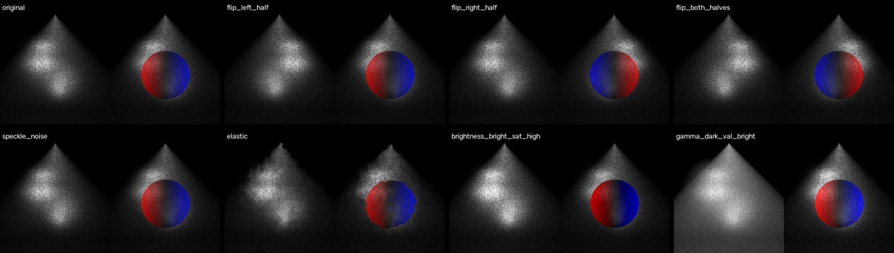
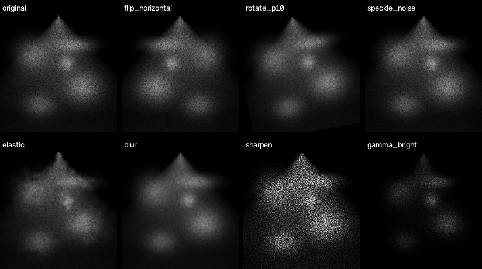
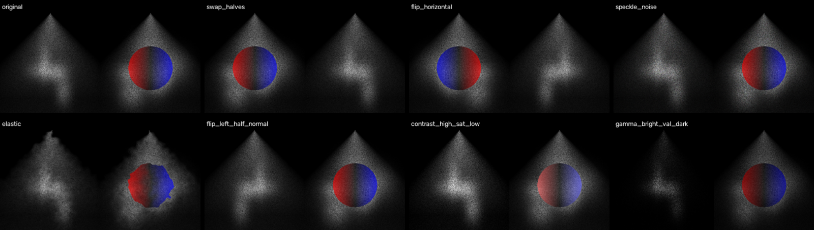

# Domain-specific data augmentation for ultrasound images

Augmenting a small ultrasound dataset without breaking what defines each class.



> **No medical data in this repository.** All images shown here are synthetic,
> generated with NumPy and OpenCV by `generate_demo.py`, purely to illustrate
> the pipeline.

---

## The problem

Ultrasound images used for classification fall into three structural categories:

| Category | Layout |
|---|---|
| **simple** | a single window, any aspect ratio |
| **doppler** | two windows of equal width: grayscale on the left, the *same* image with a colour Doppler overlay on the right |
| **independent** | two windows of equal width, showing two *different* views |

Datasets of this kind are typically small, so augmentation is necessary. But
generic augmentation breaks them: a horizontal flip of a whole Doppler image
produces something that is no longer a Doppler image at all.

Each transformation here is therefore chosen so that **the category definition
survives it**.

---

## Design decisions

**Left and right halves are treated separately.** For `doppler` and
`independent`, the split is what defines the class. Halves are flipped and
adjusted independently, then recombined.

**Geometry is excluded from half-image transforms.** Rotation, zoom and elastic
deformation are applied to the full image only. Applied to one half, they leave
visible seams once the halves are concatenated.

**Hue is never modified on Doppler overlays.** In colour Doppler, hue encodes
flow direction and magnitude: red and blue are not decoration, they are the
measurement. Photometric augmentation therefore works in HSV space and alters
saturation and value only, leaving H untouched.

**Noise models match the modality.** Speckle noise (multiplicative) is the
characteristic noise of ultrasound, so it is included alongside additive
Gaussian and salt-and-pepper noise.

**Elastic deformation has a physical justification.** Varying probe pressure
deforms soft tissue, so a smooth random displacement field is a realistic
augmentation here, not an arbitrary one.

---

## Contents

```
augmentation.py      augmentation functions and dataset pipeline
generate_demo.py     synthetic demo images and result montages
examples/            montages showing a sample of augmentations per category
requirements.txt
```

### Transformations

| Group | Transforms |
|---|---|
| Geometric | vertical flip, rotation (±5°, ±10°, ±15°), centre zoom |
| Noise | Gaussian, speckle, salt-and-pepper |
| Filtering | Gaussian blur, sharpening |
| Deformation | elastic deformation |
| Photometric (grayscale) | brightness, contrast, gamma correction |
| Photometric (colour) | saturation and value in HSV, hue preserved |
| Structural | per-half flips, half swapping (`independent` only) |

For the two-window categories, left and right transforms are combined
exhaustively, which yields on the order of 150 variants per source image.
`max_per_image` caps this with a reproducible random subsample.

---

## Usage

```bash
pip install -r requirements.txt

# Generate the synthetic demo set and the montages
python generate_demo.py

# Augment a dataset of your own
python augmentation.py
```

Expected input layout:

```
dataset/
├── simple/
├── doppler/
└── independent/
```

Output is written to `dataset_augmented/`, preserving the same structure.

```python
from augmentation import augment_dataset

augment_dataset("dataset", "dataset_augmented", max_per_image=30, seed=0)
```

---

## Examples

**simple**



**independent**



---

## Requirements

Python 3.9+, NumPy, OpenCV.

## Licence

MIT.
